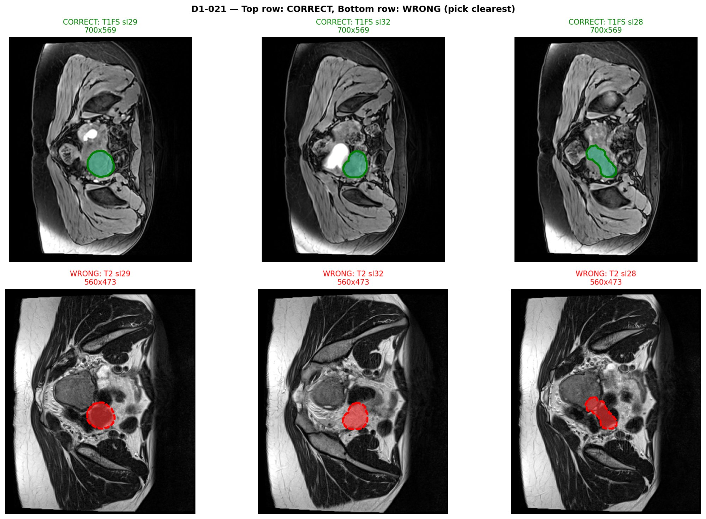
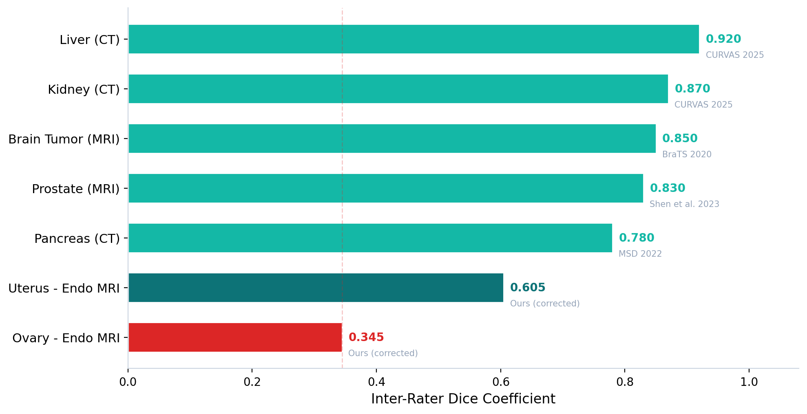
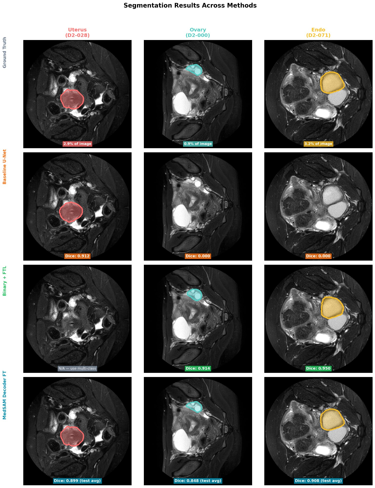

# EndoSAM: Pelvic Organ Segmentation for Endometriosis Diagnosis

Segmenting uterus, ovary, and endometrioma in pelvic MRI on the UT-EndoMRI dataset (124 subjects), and finding that a mask alignment problem, not the model, was the biggest bottleneck. ENGG\*6302 Medical Image Processing, University of Guelph.

**MedSAM with decoder fine-tuning: 0.857 / 0.783 / 0.744 Dice** (uterus / ovary / endometrioma). The report presents this as the first evaluation of MedSAM on pelvic endometriosis MRI and the first endometrioma segmentation result (0.556 Dice when detected, binary U-Net).

*Mask misalignment in subject D1-021 across three slices. Top row: correct alignment on T1FS (700 by 569 pixels). Bottom row: the same mask overlaid on T2 (560 by 473 pixels), showing the spatial shift that degrades Dice from 0.85+ to 0.35 (Figure 3 of the report).*

---

## Results at a glance

| Method | Uterus | Ovary | Endometrioma |
|---|---|---|---|
| **MedSAM decoder fine-tuning (234 slices)** | **0.857** | **0.783** | **0.744** |
| MedSAM oracle box, zero-shot (304 slices) | 0.842 | 0.744 | 0.696 |
| MedSAM simulated manual box (304 slices) | 0.805 | 0.683 | 0.641 |
| Baseline U-Net | 0.656 | 0.000 | 0.000 |
| Attention U-Net | 0.557 | 0.000 | 0.225 |
| Binary U-Net (Focal Tversky) | n/a | 0.298 | 0.556* |
| RAovSeg (published) | n/a | 0.290 | n/a |
| nnU-Net (published) | n/a | 0.272 | n/a |
| Inter-rater (measured) | 0.605 | 0.345 | n/a |

\* When detected. Overall mean 0.389 (70 test slices).

## The largest improvement was a data fix

52% of subjects had spatial misalignment between masks and images due to multi-sequence MRI acquisition: the radiologist annotated on whichever sequence showed the organ best, but a standard loader takes the first image file. Matching each mask to the image with the same dimensions raised usable subjects from 59 to 96 and MedSAM uterus Dice from **0.356 to 0.842** (+0.486), more than any model change in the study.

## Radiologists disagree on ovary boundaries

*Corrected inter-rater Dice across medical segmentation tasks. Values for other organs are from published benchmarks (Figure 4 of the report).*

After excluding 8 of 35 rater comparisons made on different sequences, corrected inter-rater Dice is 0.605 ± 0.386 for uterus and 0.345 ± 0.377 for ovary. The ovary value is lower than liver (0.92), kidney (0.87), prostate (0.83), and pancreas (0.78). The report notes that direct comparison is approximate, since each task uses different datasets and annotation protocols.

## Qualitative results

*Test subjects D2-028 (uterus), D2-000 (ovary), and D2-071 (endometrioma). Row 1: ground truth. Row 2: baseline U-Net. Row 3: binary model. Row 4: MedSAM decoder (Figure 6 of the report).*

## Read more

- **[Full report (PDF)](report/EndoSAM_FinalReport.pdf)**
- [Methodology](docs/methodology.md), [Results](docs/results.md), [References](docs/references.md)

## A note on code

Solution code is kept private in line with course academic-integrity policy. I'm happy to walk through the implementation, the alignment fix, and the MedSAM fine-tuning approach with anyone interested.

## Author

**Antony Gerold Arockiasamy**, ENGG\*6302 Medical Image Processing, University of Guelph.

## License

Documentation and figures: MIT, see [LICENSE](LICENSE).
